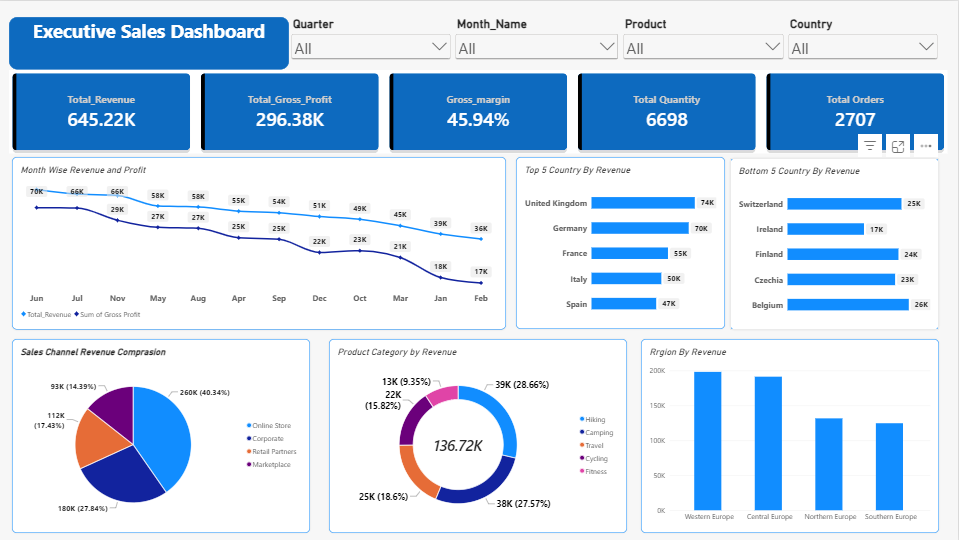

# 📊 Sales Executive Dashboard | Power BI

## 📌 Project Overview
Interactive Sales Executive Dashboard built using Microsoft Power BI to analyze sales performance and monitor key business KPIs. This dashboard helps understand revenue, profitability, product performance, and regional sales trends.

## 🎯 Key Performance Indicators (KPIs)
- 💰 Total Revenue: 645.22K
- 📈 Total Gross Profit: 296.38K
- 📊 Gross Margin: 45.94%
- 📦 Total Quantity: 6,698
- 🛒 Total Orders: 2,707

## 📊 Dashboard Analysis
- Monthly Revenue & Gross Profit Trends
- Top 5 Countries by Revenue
- Bottom 5 Countries by Revenue
- Sales Channel Revenue Contribution
- Product Category Revenue Analysis
- Regional Revenue Comparison

## 🎛️ Interactive Filters
- Quarter
- Month
- Product
- Country

## 🛠️ Tools & Technologies
- Microsoft Power BI
- Power Query
- DAX
- Data Visualization
- Business Intelligence

## 📷 Dashboard Preview
Dashboard screenshot will be added here.

## 📁 Project Files
- Power BI Dashboard (.pbix)
- Dashboard Screenshot (.png)

## 🎯 Project Objective
To transform raw sales data into meaningful business insights using interactive visualizations and KPI analysis, helping businesses make data-driven decisions.

## 👨‍💻 About Me
Aspiring Data Analyst | SQL | Excel | Power BI | Python

Dashboard screenshot will be added here.
## 📷 Dashboard Preview

